# CloudMeet 架构图集

## 1. 整体架构图（系统全景）

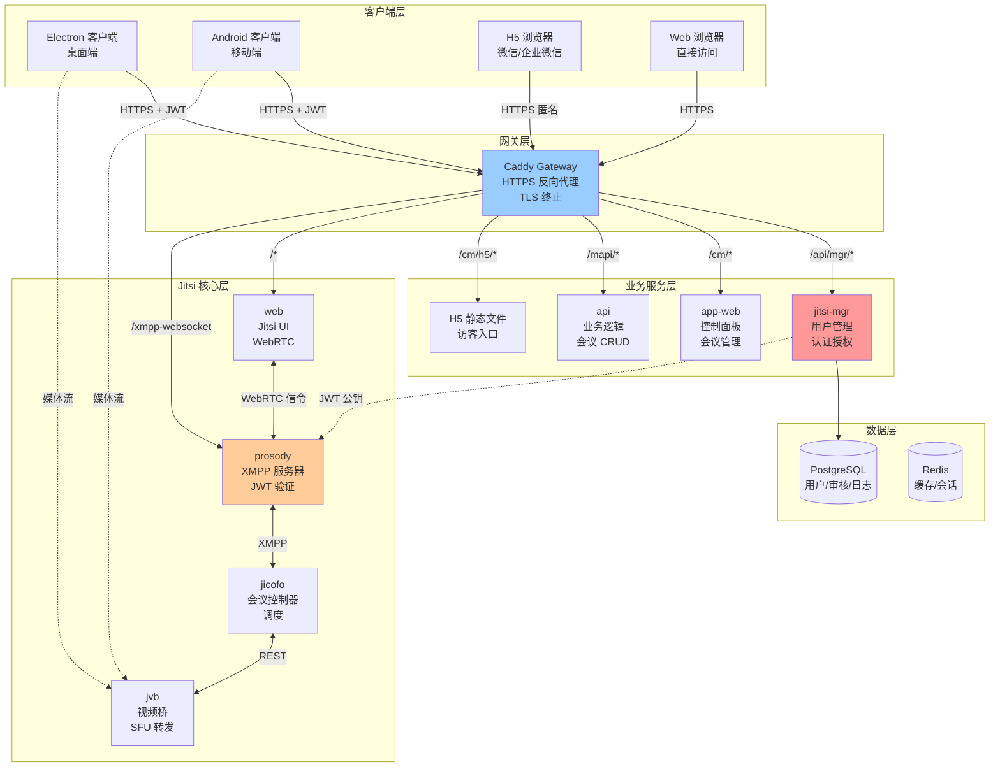

## 2. 认证流程图（用户登录）

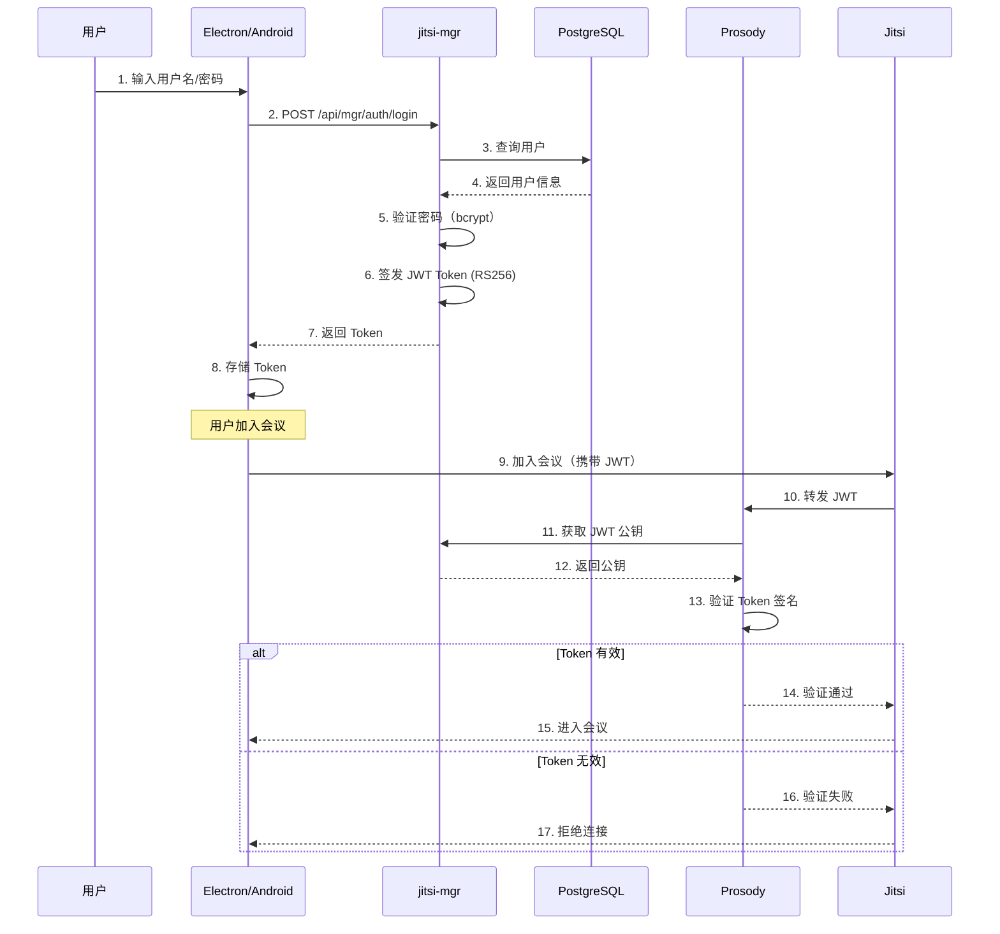

## 3. 注册审核流程图

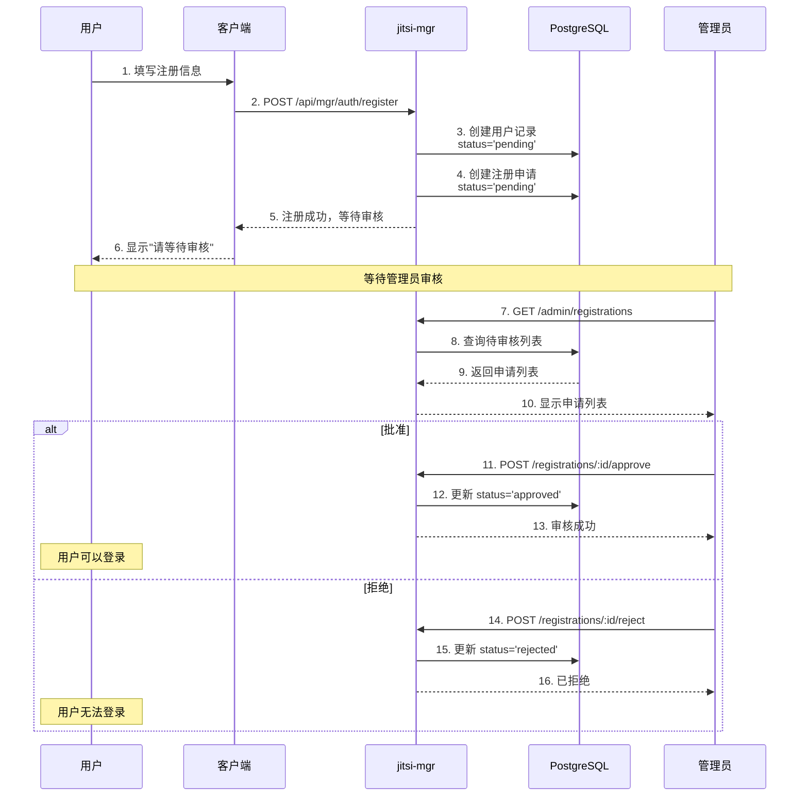

## 4. H5 访客流程图

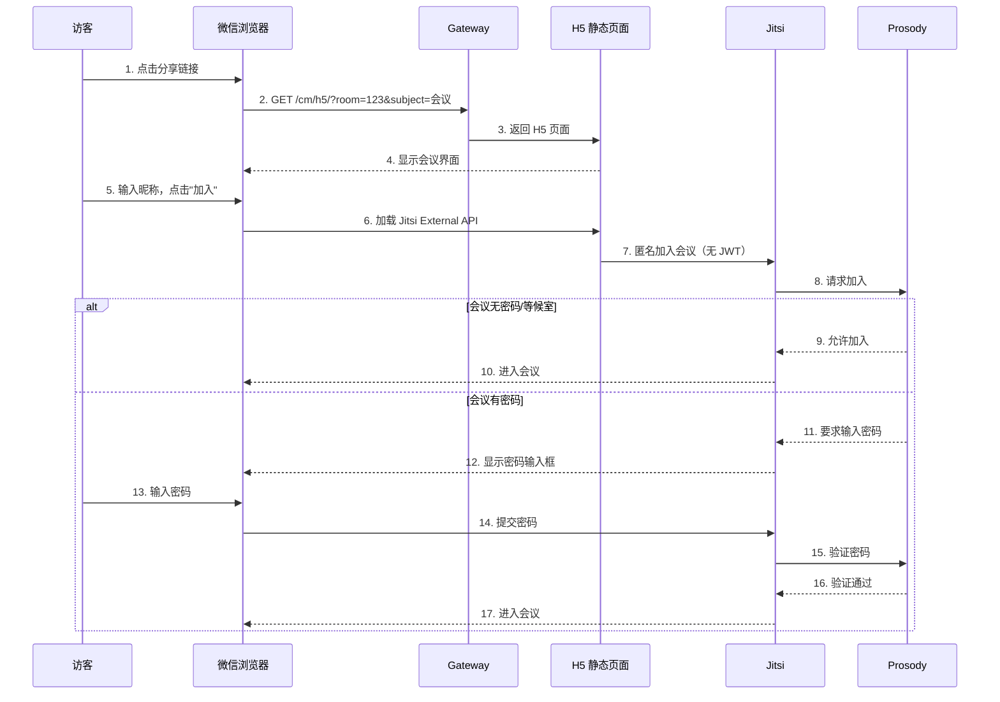

## 5. 服务部署拓扑图

```mermaid
graph TB
    subgraph "公网"
        Internet[互联网用户]
    end

    subgraph "物理服务器 (Ubuntu 22.04, 8C16G)"
        subgraph "Docker Compose 网络: cloudmeet-network"
            GW[gateway<br/>Caddy:8443]
            MGR[jitsi-mgr<br/>Node.js:3000]
            APP[app-web<br/>:3001]
            API[api<br/>:3002]
            WEB[web<br/>Jitsi:80]
            PRO[prosody<br/>XMPP:5222/5280]
            JIC[jicofo<br/>:8888]
            JVB[jvb<br/>UDP:10000]
            DB[(PostgreSQL<br/>:5432)]
        end

        subgraph "持久化卷"
            V1[/data/postgres]
            V2[/data/caddy_data]
            V3[/data/jitsi-mgr]
            V4[/data/prosody]
        end
    end

    Internet -->|HTTPS:8443| GW
    Internet -.UDP:10000.-> JVB

    GW --> MGR
    GW --> APP
    GW --> API
    GW --> WEB
    GW --> PRO

    MGR --> DB
    PRO --> JIC
    JIC --> JVB

    DB --> V1
    GW --> V2
    MGR --> V3
    PRO --> V4

    style GW fill:#99ccff
    style MGR fill:#ff9999
    style DB fill:#ffcc99
```

## 6. 数据库 ER 图

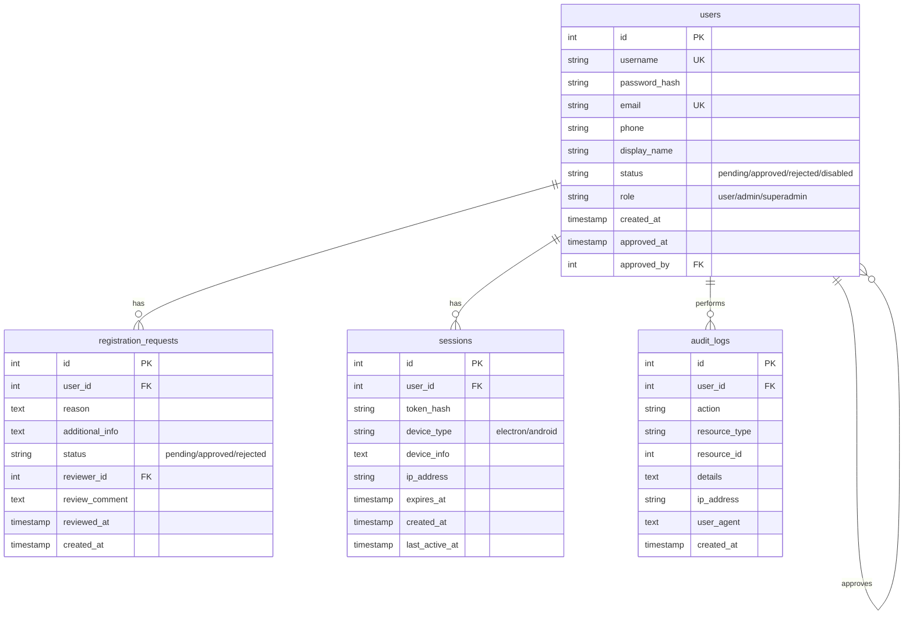

## 7. JWT Token 流转图

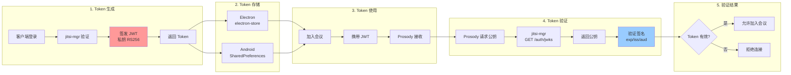

## 8. 权限分层图

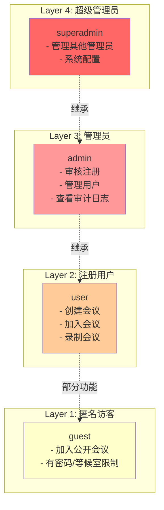

## 9. 路由分发图

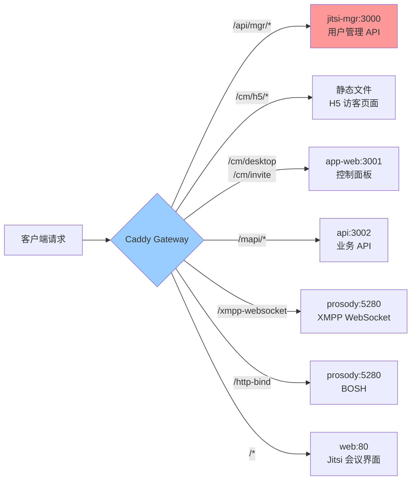

## 10. 媒体流向图

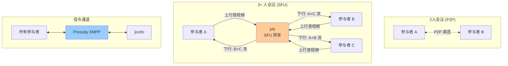

## 11. 扩展部署拓扑图

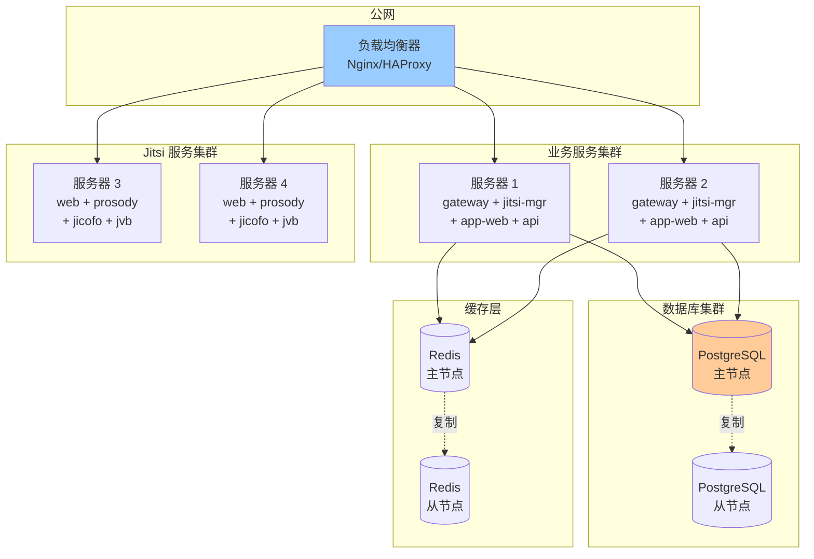

## 12. 安全边界图

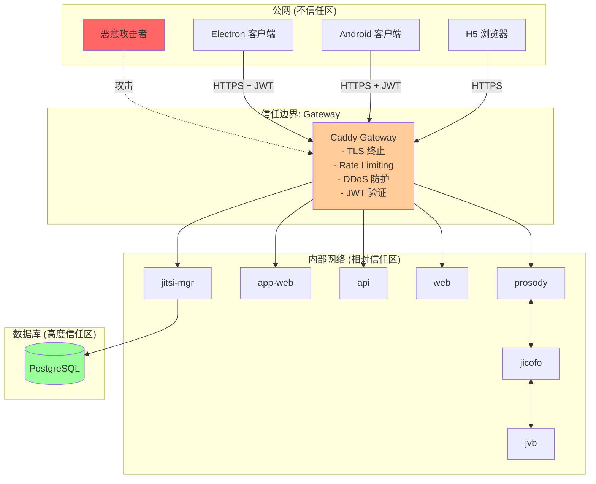

---

## 使用说明

### 在线渲染

这些 Mermaid 图可以在以下平台渲染：
- GitHub/GitLab（原生支持）
- VS Code（安装 Mermaid 插件）
- 在线工具：https://mermaid.live/

### 导出 PNG/SVG

```bash
# 安装 mermaid-cli
npm install -g @mermaid-js/mermaid-cli

# 导出 PNG
mmdc -i diagrams.md -o architecture.png

# 导出 SVG
mmdc -i diagrams.md -o architecture.svg
```

### 编辑建议

- 使用 VS Code + Mermaid Preview 插件实时预览
- 调整 `style` 语句自定义颜色
- 添加 `subgraph` 分组相关节点

---

**文档维护**：
- 创建日期：2026-11-25
- 图表总数：12 张
- 格式：Mermaid
- 覆盖范围：架构、流程、部署、数据
